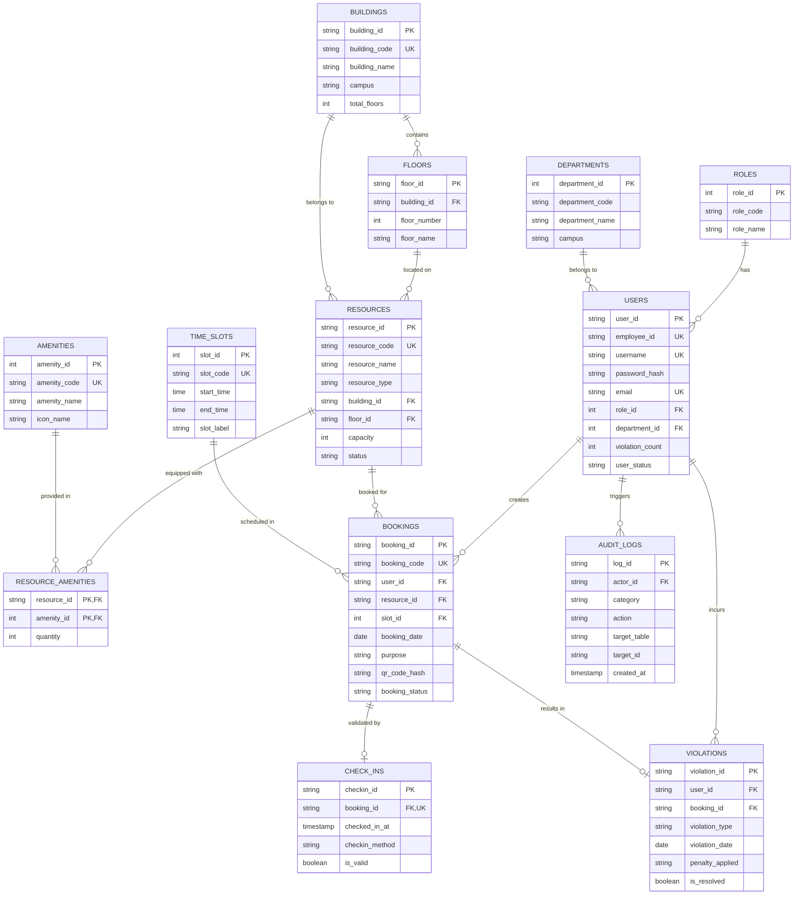

# TÀI LIỆU KIẾN TRÚC CƠ SỞ DỮ LIỆU F-SPACE BOOKING
**Hệ Thống Quản Lý Đặt Phòng Họp & Không Gian Làm Việc FPT Software (F-Town Campuses)**
*Tài liệu kỹ thuật & Báo cáo đồ án tốt nghiệp*

---

## 1. TỔNG QUAN KIẾN TRÚC DỮ LIỆU (DUAL-TIER DATABASE ARCHITECTURE)

Hệ thống F-Space Booking được thiết kế theo mô hình **Kiến trúc Dữ liệu Hai Tầng (Dual-Tier Enterprise Architecture)** nhằm đáp ứng đồng thời 2 yêu cầu:
1. **Tầng Client (Mobile Android Room SQLite):** Đảm bảo ứng dụng di động hoạt động mượt mà offline-first, lưu trữ cache người dùng, tài nguyên không gian làm việc, danh sách lịch đặt chỗ cá nhân, và hỗ trợ quét mã QR điểm danh ngay cả khi mất kết nối mạng tạm thời.
2. **Tầng Máy chủ Trung tâm (Backend Relational DB - PostgreSQL 14+ / MySQL 8.0+):** Đảm bảo toàn vẹn dữ liệu chuẩn hóa cấp độ 3NF, xử lý giao dịch đồng thời (ACID Transactions), kiểm soát chống trùng lịch (Anti-Double Booking) bằng Pessimistic Row Locking (`FOR UPDATE`), và tự động hóa phạt vi phạm No-Show (UC12).

---

## 2. SƠ ĐỒ THỰC THỂ QUAN HỆ (ENTITY RELATIONSHIP DIAGRAM - ERD)



---

## 3. TỪ ĐIỂN DỮ LIỆU CHI TIẾT (DATA DICTIONARY - 13 THỰC THỂ)

### 3.1. Bảng `roles` (Vai trò người dùng)
| Trường | Kiểu dữ liệu | Ràng buộc | Ý nghĩa |
| :--- | :--- | :--- | :--- |
| `role_id` | SERIAL / INT | PRIMARY KEY | Khóa chính tự tăng |
| `role_code` | VARCHAR(30) | UNIQUE, NOT NULL | Mã vai trò: `ADMIN`, `EMPLOYEE`, `MANAGER` |
| `role_name` | VARCHAR(100) | NOT NULL | Tên hiển thị vai trò |
| `description`| TEXT | NULLABLE | Mô tả quyền hạn |

### 3.2. Bảng `departments` (Khối ban / Đơn vị chiến lược FSU)
| Trường | Kiểu dữ liệu | Ràng buộc | Ý nghĩa |
| :--- | :--- | :--- | :--- |
| `department_id` | SERIAL / INT | PRIMARY KEY | Khóa chính tự tăng |
| `department_code` | VARCHAR(50) | UNIQUE, NOT NULL | Mã phòng ban: `FSU1.BU2`, `FSU2.DX`, `FHN.FIN` |
| `department_name` | VARCHAR(150) | NOT NULL | Tên đầy đủ phòng ban |
| `campus` | VARCHAR(100) | NOT NULL | Cơ sở: F-Town 1, F-Town 2, F-Town 3, FPT Tower |

### 3.3. Bảng `users` (Tài khoản nhân sự FPT)
| Trường | Kiểu dữ liệu | Ràng buộc | Ý nghĩa |
| :--- | :--- | :--- | :--- |
| `user_id` | VARCHAR(50) | PRIMARY KEY | Định danh người dùng (`usr_namtv`, `usr_ducbt`) |
| `employee_id` | VARCHAR(30) | UNIQUE, NOT NULL | Mã nhân viên FPT: `ADM001`, `EMP302`, `EMP002` |
| `username` | VARCHAR(50) | UNIQUE, NOT NULL | Tên đăng nhập |
| `password_hash` | VARCHAR(255) | NOT NULL | Mật khẩu băm an toàn (BCrypt / SHA-256) |
| `email` | VARCHAR(120) | UNIQUE, NOT NULL | Email doanh nghiệp (`@fpt.com`) |
| `role_id` | INT | FOREIGN KEY (`roles`) | Vai trò của tài khoản |
| `department_id` | INT | FOREIGN KEY (`departments`) | Thuộc bộ phận nào |
| `violation_count`| INT | NOT NULL, DEFAULT 0 | Số lần vi phạm No-Show |
| `user_status` | VARCHAR(30) | DEFAULT 'ACTIVE' | Trạng thái: `ACTIVE`, `WARNING`, `LOCKED` |

### 3.4. Bảng `buildings` (Tòa nhà Campus)
| Trường | Kiểu dữ liệu | Ràng buộc | Ý nghĩa |
| :--- | :--- | :--- | :--- |
| `building_id` | VARCHAR(50) | PRIMARY KEY | Mã tòa: `BLD_FTOWN1`, `BLD_FTOWN2`, `BLD_FTOWN3` |
| `building_code` | VARCHAR(30) | UNIQUE, NOT NULL | Mã hiển thị: `FTOWN-1`, `FTOWN-3` |
| `building_name` | VARCHAR(100) | NOT NULL | Tên tòa nhà |
| `campus` | VARCHAR(100) | NOT NULL | Khu Công nghệ cao TP.HCM / Hà Nội |
| `total_floors` | INT | NOT NULL, DEFAULT 1 | Tổng số tầng lầu |

### 3.5. Bảng `floors` (Tầng lầu)
| Trường | Kiểu dữ liệu | Ràng buộc | Ý nghĩa |
| :--- | :--- | :--- | :--- |
| `floor_id` | VARCHAR(50) | PRIMARY KEY | Mã tầng: `FLR_FT3_F1`, `FLR_FT3_F2` |
| `building_id` | VARCHAR(50) | FOREIGN KEY (`buildings`) | Thuộc tòa nhà nào |
| `floor_number` | INT | NOT NULL | Số thứ tự tầng (1, 2, 3...) |
| `floor_name` | VARCHAR(50) | NOT NULL | Tên khu vực tầng |
| `floor_plan_asset` | TEXT | NULLABLE | Đường dẫn sơ đồ mặt bằng (Blueprint SVG/Vector) |

### 3.6. Bảng `amenities` (Tiện ích văn phòng)
| Trường | Kiểu dữ liệu | Ràng buộc | Ý nghĩa |
| :--- | :--- | :--- | :--- |
| `amenity_id` | SERIAL / INT | PRIMARY KEY | Khóa chính tiện ích |
| `amenity_code` | VARCHAR(50) | UNIQUE, NOT NULL | Mã tiện ích: `WIFI_6`, `POLYCOM_VC`, `TV_4K_75` |
| `amenity_name` | VARCHAR(100) | NOT NULL | Tên hiển thị: Wi-Fi 6, Polycom, Bảng viết |
| `icon_name` | VARCHAR(50) | NOT NULL | Tên icon vector trên ứng dụng di động |

### 3.7. Bảng `resources` (Không gian: Phòng họp & Chỗ ngồi)
| Trường | Kiểu dữ liệu | Ràng buộc | Ý nghĩa |
| :--- | :--- | :--- | :--- |
| `resource_id` | VARCHAR(50) | PRIMARY KEY | Mã phòng/bàn: `res_1`, `res_2`, `res_6` |
| `resource_code` | VARCHAR(50) | UNIQUE, NOT NULL | Mã nhận diện: `ROOM-GOSLING-FT3` |
| `resource_name` | VARCHAR(100) | NOT NULL | Tên phòng: Phòng họp Gosling, Bàn Desk-A101 |
| `resource_type` | VARCHAR(30) | NOT NULL | Loại hình: `ROOM` (Phòng họp), `DESK` (Bàn làm việc) |
| `building_id` | VARCHAR(50) | FOREIGN KEY (`buildings`) | Tòa nhà |
| `floor_id` | VARCHAR(50) | FOREIGN KEY (`floors`) | Tầng lầu |
| `capacity` | INT | NOT NULL, DEFAULT 1 | Sức chứa người tối đa |
| `status` | VARCHAR(30) | DEFAULT 'AVAILABLE' | `AVAILABLE`, `BOOKED`, `MAINTENANCE` |

### 3.8. Bảng `resource_amenities` (Bảng nối Nhiều - Nhiều N:N)
| Trường | Kiểu dữ liệu | Ràng buộc | Ý nghĩa |
| :--- | :--- | :--- | :--- |
| `resource_id` | VARCHAR(50) | PK, FK (`resources`) | Mã tài nguyên |
| `amenity_id` | INT | PK, FK (`amenities`) | Mã tiện ích |
| `quantity` | INT | DEFAULT 1 | Số lượng trang bị trong phòng |

### 3.9. Bảng `time_slots` (Khung giờ đặt tiêu chuẩn)
| Trường | Kiểu dữ liệu | Ràng buộc | Ý nghĩa |
| :--- | :--- | :--- | :--- |
| `slot_id` | INT | PRIMARY KEY | ID khung giờ (1..5) |
| `slot_code` | VARCHAR(20) | UNIQUE, NOT NULL | Mã ca: `SLOT_01`, `SLOT_02` |
| `start_time` | TIME | NOT NULL | Giờ bắt đầu (08:00, 10:00, 13:00...) |
| `end_time` | TIME | NOT NULL | Giờ kết thúc (10:00, 12:00, 15:00...) |
| `slot_label` | VARCHAR(50) | NOT NULL | Nhãn ca làm việc |

### 3.10. Bảng `bookings` (Đơn đặt chỗ làm việc)
| Trường | Kiểu dữ liệu | Ràng buộc | Ý nghĩa |
| :--- | :--- | :--- | :--- |
| `booking_id` | VARCHAR(50) | PRIMARY KEY | Mã đơn: `BK-20261020-001` |
| `booking_code` | VARCHAR(50) | UNIQUE, NOT NULL | Mã hiển thị vé: `FSP-GOSLING-01` |
| `user_id` | VARCHAR(50) | FOREIGN KEY (`users`) | Người đặt |
| `resource_id` | VARCHAR(50) | FOREIGN KEY (`resources`) | Phòng hoặc bàn được đặt |
| `slot_id` | INT | FOREIGN KEY (`time_slots`) | Khung giờ đặt |
| `booking_date` | DATE | NOT NULL | Ngày sử dụng phòng |
| `purpose` | VARCHAR(255) | DEFAULT 'Họp công việc' | Mục đích cuộc họp |
| `attendee_count`| INT | DEFAULT 1 | Số người tham gia |
| `qr_code_hash` | VARCHAR(255) | NOT NULL | Mã băm SHA-256 bảo mật trên vé QR Code |
| `booking_status`| VARCHAR(30) | DEFAULT 'CONFIRMED' | `CONFIRMED`, `CHECKED_IN`, `CANCELLED`, `NO_SHOW` |

> [!IMPORTANT]
> **Ràng buộc Chống Trùng Đặt Phòng (Anti-Double Booking Constraint):**
> Trong PostgreSQL: Sử dụng Partial Unique Index:
> ```sql
> CREATE UNIQUE INDEX uq_anti_double_booking 
> ON bookings (resource_id, booking_date, slot_id) 
> WHERE booking_status NOT IN ('CANCELLED');
> ```
> Điều này đảm bảo tuyệt đối ở mức Database Engine không bao giờ có 2 đơn đặt cùng 1 phòng tại 1 khung giờ cùng ngày, đồng thời giải phóng khung giờ tức thì khi đơn cũ bị `CANCELLED`.

### 3.11. Bảng `check_ins` (Điểm danh & Quét mã QR)
| Trường | Kiểu dữ liệu | Ràng buộc | Ý nghĩa |
| :--- | :--- | :--- | :--- |
| `checkin_id` | VARCHAR(50) | PRIMARY KEY | Khóa chính lần check-in |
| `booking_id` | VARCHAR(50) | UNIQUE, FK (`bookings`) | Liên kết 1:1 với đơn đặt |
| `checked_in_at` | TIMESTAMPTZ | DEFAULT CURRENT_TIMESTAMP | Thời điểm quét mã QR thành công |
| `checkin_method`| VARCHAR(30) | DEFAULT 'QR_SCAN' | Phương thức: `QR_SCAN`, `MANUAL_ADMIN` |
| `device_ip` | VARCHAR(50) | NULLABLE | Địa chỉ IP của thiết bị check-in |
| `is_valid` | BOOLEAN | DEFAULT TRUE | Điểm danh hợp lệ |

### 3.12. Bảng `violations` (Lịch sử vi phạm No-Show - UC12)
| Trường | Kiểu dữ liệu | Ràng buộc | Ý nghĩa |
| :--- | :--- | :--- | :--- |
| `violation_id` | VARCHAR(50) | PRIMARY KEY | Mã vi phạm |
| `user_id` | VARCHAR(50) | FOREIGN KEY (`users`) | Nhân viên vi phạm |
| `booking_id` | VARCHAR(50) | FOREIGN KEY (`bookings`) | Đơn đặt bị bỏ hoang (No-show) |
| `violation_type`| VARCHAR(30) | NOT NULL | Loại vi phạm: `NO_SHOW`, `OVERSTAY` |
| `violation_date`| DATE | NOT NULL | Ngày xảy ra vi phạm |
| `penalty_applied`| VARCHAR(50)| DEFAULT 'WARNING_RECORDED'| `WARNING_RECORDED`, `ACCOUNT_LOCKED` |
| `is_resolved` | BOOLEAN | DEFAULT FALSE | Trạng thái đã được Admin xử lý mở khóa chưa |

### 3.13. Bảng `audit_logs` (Nhật ký kiểm toán an ninh - UC08)
| Trường | Kiểu dữ liệu | Ràng buộc | Ý nghĩa |
| :--- | :--- | :--- | :--- |
| `log_id` | VARCHAR(50) | PRIMARY KEY | Mã nhật ký |
| `actor_id` | VARCHAR(50) | FOREIGN KEY (`users`) | Người thực hiện hành động |
| `category` | VARCHAR(30) | NOT NULL | `AUTH`, `SYS`, `ADMIN`, `BOOKING`, `CHECKIN`, `VIOLATION` |
| `action` | VARCHAR(50) | NOT NULL | Tên hành động: `USER_LOGIN`, `CREATE_BOOKING`, `LOCK_USER` |
| `target_table` | VARCHAR(50) | NULLABLE | Tên bảng bị tác động |
| `target_id` | VARCHAR(50) | NULLABLE | ID bản ghi bị tác động |
| `details_json` | JSONB / JSON | NULLABLE | Dữ liệu chi tiết dạng JSON |

---

## 4. CƠ CHẾ CHỐNG XUNG ĐỘT ĐỒNG THỜI (ACID CONCURRENCY CONTROL)

Khi nhiều nhân viên cùng bấm "Đặt phòng" vào cùng một giây cho một phòng hot (ví dụ: Phòng họp Gosling Tầng 3), hệ thống áp dụng cơ chế **Pessimistic Row Locking (`SELECT ... FOR UPDATE`)** kết hợp **Partial Unique Index**:

```sql
-- Bước 1: Khóa dòng tài nguyên để xếp hàng các giao dịch đồng thời
PERFORM resource_id FROM resources WHERE resource_id = p_resource_id FOR UPDATE;

-- Bước 2: Kiểm tra xung đột trước khi insert
SELECT COUNT(*) INTO v_conflict_cnt
FROM bookings
WHERE resource_id = p_resource_id 
  AND booking_date = p_booking_date 
  AND slot_id = p_slot_id 
  AND booking_status NOT IN ('CANCELLED');

-- Bước 3: Nếu phát hiện trùng, rollback và trả về thông báo rõ ràng
IF v_conflict_cnt > 0 THEN
    RETURN QUERY SELECT FALSE, NULL, 'Khung giờ này đã được đồng nghiệp khác đặt trước.';
    RETURN;
END IF;
```

---

## 5. QUY CHẾ TỰ ĐỘNG HÓA NO-SHOW & KHÓA TÀI KHOẢN (UC12 WORKFLOW)

Quy trình quản lý vi phạm No-Show theo tài liệu đặc tả đồ án:
1. **Thời hạn Check-in:** Nhân viên được phép quét mã QR trong khoảng từ 15 phút trước giờ họp đến **15 phút sau giờ bắt đầu ca**.
2. **Kích hoạt No-Show:** Sau 15 phút kể từ khi ca họp bắt đầu, nếu đơn đặt vẫn ở trạng thái `CONFIRMED` mà chưa có bản ghi trong `check_ins`:
   - Hệ thống (thông qua Stored Procedure `sp_auto_process_noshow`) tự động chuyển `booking_status = 'NO_SHOW'`.
   - Tạo 1 bản ghi vào bảng `violations`.
   - Tăng `users.violation_count = violation_count + 1`.
3. **Chế tài xử phạt:**
   - **Lần 1 - 2:** `user_status = 'WARNING'` (Cảnh cáo, gửi email nhắc nhở).
   - **Lần 3 trở lên:** `user_status = 'LOCKED'` (Khóa tài khoản tự động).
   - Khi tài khoản bị `LOCKED`, thủ tục `sp_create_booking_safe` và App Mobile sẽ từ chối mọi yêu cầu đặt phòng mới cho đến khi Quản trị viên (Admin) phê duyệt mở khóa trong phân hệ Quản lý tài khoản (UC07).

---

## 6. HƯỚNG DẪN TRIỂN KHAI & KIỂM THỬ

### Cài đặt trên PostgreSQL
```bash
# Đăng nhập PostgreSQL
psql -U postgres -h localhost

# Tạo database
CREATE DATABASE fspace_db;

# Chạy script khởi tạo schema và seed data
\c fspace_db
\i backend_db/fspace_schema_postgres.sql
```

### Cài đặt trên Docker
```bash
docker run --name fspace-postgres \
  -e POSTGRES_DB=fspace_db \
  -e POSTGRES_PASSWORD=fspace_secret \
  -p 5432:5432 -d postgres:16-alpine

# Import script
docker exec -i fspace-postgres psql -U postgres -d fspace_db < backend_db/fspace_schema_postgres.sql
```

### Cài đặt trên MySQL / MariaDB (XAMPP / Workbench)
```bash
mysql -u root -p -e "CREATE DATABASE fspace_db CHARACTER SET utf8mb4 COLLATE utf8mb4_unicode_ci;"
mysql -u root -p fspace_db < backend_db/fspace_schema_mysql.sql
```
